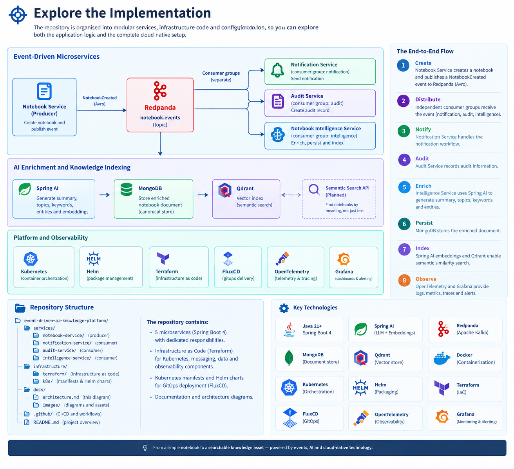

# Event-Driven AI Knowledge Platform

### From business events to intelligent, searchable knowledge.

**What if every notebook could become a source of searchable knowledge?**

This project demonstrates how a conventional Spring Boot application can evolve into an **AI-enabled, event-driven microservices platform**. A single `NotebookCreated` event triggers independent business processes for notifications, auditing, and AI-powered content enrichment—without tightly coupling the services to one another.

Built with **Java, Spring Boot 4, Redpanda (Kafka), Spring AI, MongoDB, PostgreSQL, Qdrant, and Terraform**, the platform brings together modern application development, asynchronous messaging, generative AI, vector search, GitOps, and observability in one hands-on engineering project.

**One event. Independent services. AI-enriched knowledge. Cloud-native delivery.**

## Architecture at a glance

The architecture separates event production, business processing, AI enrichment, persistence, and vector indexing into distinct responsibilities. This makes the solution easier to evolve, test, observe, and extend.

### The end-to-end journey

1. **Create** — The Notebook Service creates a notebook and publishes a `NotebookCreated` Avro event to the Redpanda topic `notebook.events`.
2. **Distribute** — Independent Kafka consumer groups receive the event, allowing notification, audit, and intelligence processing to run separately.
3. **Notify** — The Notification Service handles the notification workflow.
4. **Audit** — The Audit Service consumes the event and records the relevant audit information on a PostgreSql database.
5. **Enrich** — The Notebook Intelligence Service uses Spring AI to generate a summary and extract topics, keywords, and entities.
6. **Persist** — MongoDB stores the enriched notebook document.
7. **Index** — Spring AI embeddings and Qdrant provide the foundation for semantic similarity search.
8. **Observe** — OpenTelemetry and Grafana's alloy central collector and observability stack help investigate application behaviour, logs, metrics, traces, and alerts.

---

## From notebook content to AI-powered knowledge

The Intelligence Service is the centrepiece of this project. Instead of treating a notebook as nothing more than a record with a title and description, it transforms the content into a richer representation that can support discovery and downstream AI workflows.

| Capability                    | Technology                | Purpose                                                       |
| ----------------------------- | ------------------------- | ------------------------------------------------------------- |
| Asynchronous event processing | Redpanda / Kafka          | Decouple producers from consumers                             |
| Structured AI enrichment      | Spring AI                 | Generate summaries and extract topics, keywords, and entities |
| Document persistence          | MongoDB                   | Store the enriched notebook representation                    |
| Embedding generation          | Spring AI embedding model | Represent content as vectors                                  |
| Vector indexing               | Qdrant                    | Enable semantic similarity search                             |
| Agentic evolution             | Embabel                   | Provide a potential foundation for agent-driven workflows     |

The design deliberately separates **AI enrichment from vector indexing**. If indexing fails after a document has been persisted, the stored document can be re-indexed without repeating the AI enrichment step.

MongoDB remains the canonical document store; Qdrant serves as the vector index. Because they are separate systems, reliable recovery and reconciliation between them are important engineering concerns.

---

## Engineering beyond the application code

This repository is also a demonstration of the platform engineering practices required to run modern Java services.

* **Infrastructure as Code** — Terraform provisions supporting infrastructure such as the messaging and data services, alongside observability components.
* **GitOps delivery** — FluxCD manages Kubernetes deployments from version-controlled configuration.
* **Cloud-native packaging** — Helm charts and Kubernetes resources support repeatable deployment.
* **Observability** — OpenTelemetry instrumentation and Grafana Alloy feed telemetry into the relevant observability backends.
* **Operational insight** — Grafana dashboards and alerting help surface application errors and investigate service behaviour.
* **Automated testing** — Unit tests and integration tests can verify processing behaviour, persistence, and failure recovery.

The aim is not just to make the happy path work. It is to demonstrate how application architecture, infrastructure, delivery, and operations fit together.

---

## 🛠️ Technology stack

**Application and messaging**

Java · Spring Boot 4 · Spring AI · Redpanda · Apache Kafka · Avro

**Data and AI**

MongoDB · Qdrant · Embedding models · Semantic search

**Platform and delivery**

Docker · Kubernetes · Helm · Terraform · FluxCD

**Observability**

OpenTelemetry · Grafana Alloy · Grafana · Prometheus-compatible metrics · Loki · Tempo

---

## What this project demonstrates

* Designing loosely coupled microservices around domain events.
* Building asynchronous Kafka producers and independent consumers.
* Integrating generative AI into a Java/Spring application.
* Persisting structured AI enrichment and indexing embeddings.
* Separating operational document storage from vector search.
* Testing failure scenarios and designing recovery paths.
* Provisioning infrastructure as code and deploying with GitOps.
* Instrumenting services for logs, metrics, traces, dashboards, and alerts.

## The bigger picture

This platform is an evolving foundation for intelligent knowledge discovery. The architecture creates room for semantic retrieval, retrieval-augmented generation (RAG), and agentic workflows without requiring the core business services to become tightly coupled to a particular AI implementation.

**The goal: demonstrate how established enterprise Java engineering practices can be combined with modern AI capabilities to build systems that are modular, observable, and ready to evolve.**

---

Explore how the platform connects **event-driven microservices, AI-powered enrichment, data persistence, and cloud-native operations** into one cohesive solution.

The repository is organized around the main architectural responsibilities, making it easier to follow an event from its creation to its transformation into enriched, searchable knowledge.

| Area                             | What to explore                                                                                 |
| -------------------------------- | ----------------------------------------------------------------------------------------------- |
| 📓 **Notebook Service**          | Create notebooks and publish `NotebookCreated` events using Avro.                               |
| 📨 **Event Streaming**           | Use Redpanda and independent Kafka consumer groups to decouple services.                        |
| 🔔 **Notification Service**      | React to notebook events and handle notification processing.                                    |
| 📋 **Audit Service**             | Consume events and record audit information.                                                    |
| 🧠 **Intelligence Service**      | Use Spring AI to enrich notebook content with summaries, topics, keywords, and entities.        |
| 🍃 **Persistence & Search**      | Store enriched documents in MongoDB and index embeddings in Qdrant.                             |
| ☸️ **Infrastructure & Delivery** | Provision infrastructure with Terraform and manage Kubernetes deployments with Helm and FluxCD. |
| 📊 **Observability**             | Explore telemetry collection, dashboards, logs, metrics, traces, and alerting.                  |

### Follow the journey

**Create → Publish → Consume → Enrich → Persist → Index → Discover**

Start with the Notebook Service, follow the `NotebookCreated` event through Redpanda, and then explore how the independent consumers process it. Continue into the Intelligence Service to see how AI enrichment feeds MongoDB persistence and Qdrant indexing.

Finally, explore the infrastructure and observability components that support deployment and operation of the platform.

The objective is to demonstrate not just individual technologies, but how they work together to deliver a modular, observable, and extensible AI-enabled application.

